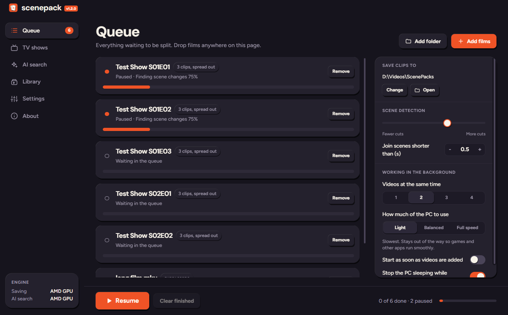
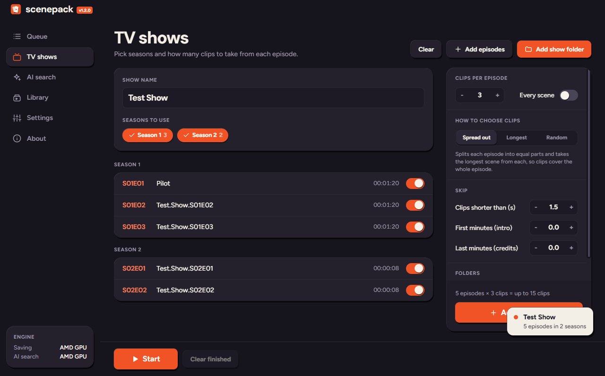
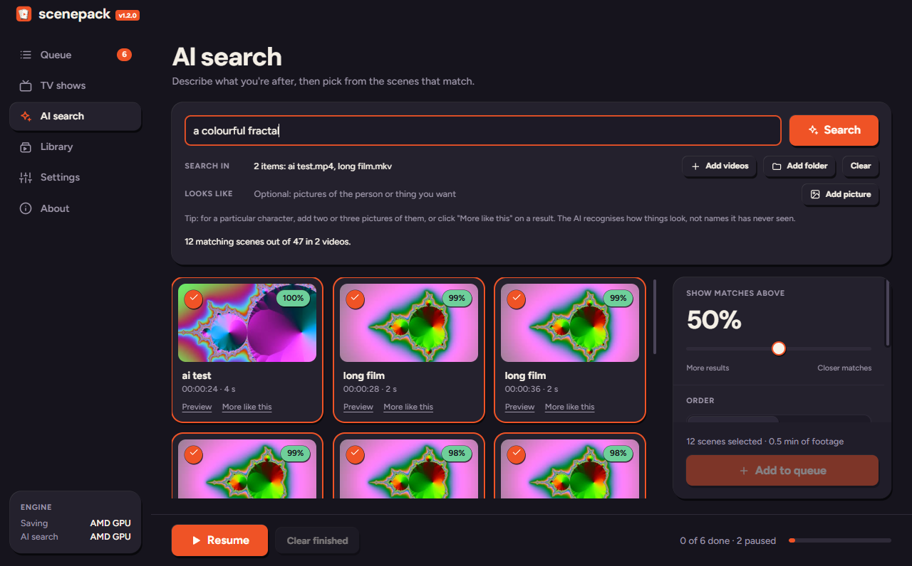
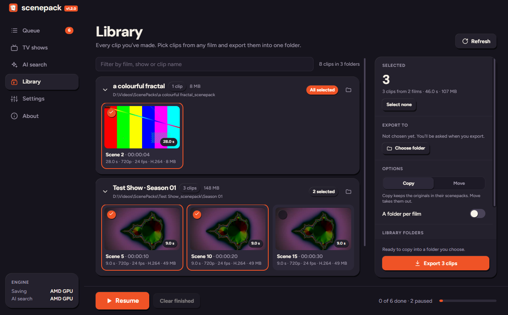
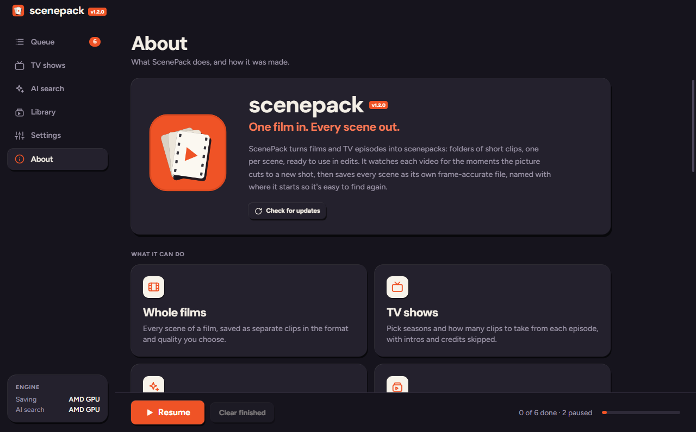
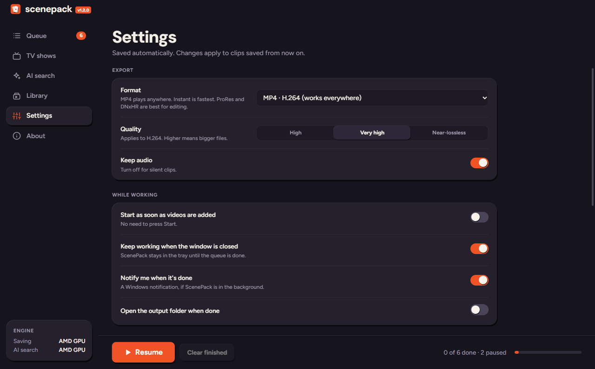
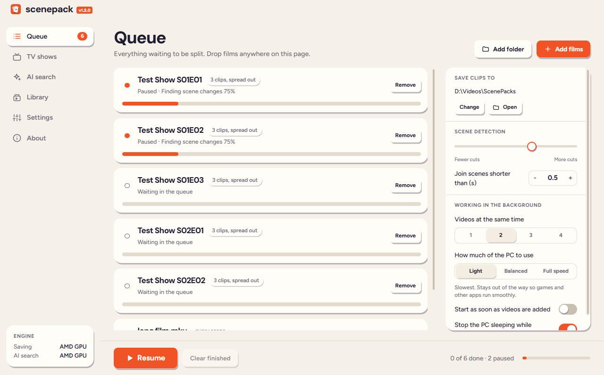

<p align="center"></p>

<h1 align="center">ScenePack</h1>

<p align="center"><b>One film in. Every scene out.</b><br>
Split films and TV episodes into scenepacks: folders of short clips, one per scene, ready to use in edits.</p>

<p align="center"></p>

## What it does

ScenePack watches each video for the moments the picture cuts to a new shot, then saves every scene as its own
frame-accurate clip, named with where it starts (for example `Avatar_scene_012_00h12m34s.mp4`) so it's easy to find again.

- **Whole films.** Every scene of a film, as separate clips, in MP4, MOV, ProRes or DNxHR.
- **TV shows.** Drop a show folder, pick seasons, and choose how many clips to take from each episode (for example 4 clips
  from every episode of season 1). Intros and credits can be skipped, and clips go into a folder per season.
- **AI search.** Describe what you want ("a blue alien with a bow in a forest") or add pictures of a character, then
  tick the matching scenes you want to keep. It works with any film or show, and runs entirely on your PC.
- **Runs in the background.** Queue as much as you like, choose how many videos run at once and how much of the PC to
  use (Light, Balanced or Full speed), pause any time, and pick up where you left off after closing the app.
- **Uses your graphics card** for scanning and saving clips (NVIDIA, AMD and Intel) and for AI search (DirectML),
  which is about 3x faster than the processor.
- **Instant mode** copies scenes without re-encoding: many times faster and original quality (cuts land on the
  nearest keyframe).
- **Simple to use.** Videos start splitting as soon as you add them, right-click any video and choose
  **Send to > ScenePack**, keep working in the tray when the window is closed, and watch progress on the taskbar button.
- **Library.** Every clip you've made, grouped by film, with hover previews and details. Pick clips from several
  films and export them into one folder, ready for editing.
- **Updates itself** from GitHub Releases: new versions download in the background and install on restart.

| TV shows | AI search |
| --- | --- |
|  |  |
| **Library** | **About** |
|  |  |
| **Settings** | **Light theme** |
|  |  |

## Download

ScenePack runs on **Windows 10 and 11** (64-bit). Other platforms aren't supported yet.

Get **ScenePack-Setup.exe** from the [latest release](../../releases/latest) and run it. FFmpeg is included.
The **Latest build** pre-release on the [Releases](../../releases) page always has the newest code from `main`.
The AI model (about 150 to 290 MB) downloads the first time you use AI search.

Windows may warn that the installer isn't signed. Click **More info**, then **Run anyway**.

## Using it

1. **Queue:** drop films on the window, or click **Add films**. Press **Start**.
2. **TV shows:** drop a show folder. ScenePack recognises names like `S01E02`, `1x02` or `Season 1/Episode 2`.
   Choose seasons and clips per episode, then **Add to queue**.
3. **AI search:** add videos, type a description, press **Search**. Click scenes to select them, then **Add to queue**.
   For a particular character, add two or three pictures of them, or click **More like this** on a good result.
   The AI recognises how things look, not names it has never seen.

Clips are saved to `Videos\ScenePacks` by default. Change it on the Queue page.

### Keyboard shortcuts

| Keys | Does |
| --- | --- |
| `Ctrl + O` | Add films |
| `Space` | Start or pause the queue |
| `Ctrl + 1` to `6` | Switch pages |
| `Ctrl + plus / minus` | Make the interface bigger or smaller |
| `Ctrl + F` | Search with AI |
| `Ctrl + ,` | Settings |

### File names

Set the pattern in **Settings > File names** using these tags: `{name}` `{num}` `{time}` `{show}` `{season}` `{episode}` `{code}`.
The default is `{name}_scene_{num}_{time}`.

## Building from source

Needs Windows, [Python 3.10+](https://www.python.org/) and [Node.js 20+](https://nodejs.org/).

```bash
pip install -r requirements.txt
npm install
npm start
```

`npm start` runs the Electron app and starts the Python backend (`python -m scenepack.server`) automatically.
FFmpeg must be installed (`winget install Gyan.FFmpeg`) when running from source.

To build the installer locally:

```bash
powershell -ExecutionPolicy Bypass -File build.ps1
```

The result is `release\ScenePack-Setup-<version>.exe`. Keep the project in a short path such as `C:\dev\ScenePack`,
because Windows tools fail on very long paths.

### Releases are automatic

`.github/workflows/build.yml` builds the installer on every push and pull request (download it from the run's
**Artifacts**). To publish a release, push a version tag:

```bash
git tag v1.0.1
git push origin v1.0.1
```

The workflow sets the version from the tag, builds the installer and attaches it to a new GitHub Release,
together with `latest.yml` and the `.blockmap` file. Installed copies check those releases every few hours, download
only the parts that changed, and install the update when ScenePack restarts (Settings > Updates).
The workflow points the app and its updater at your repository automatically. Copies built on your own PC
(with `build.ps1`) don't update themselves; install a release from GitHub once and updates take over from there.

### How it fits together

| Part | What it does |
| --- | --- |
| `electron/` | The app window (main process) and the secure bridge to the page (`preload.js`). |
| `renderer/` | The interface: plain JavaScript and Tailwind CSS (`styles.css`), no gradients, Figtree and DM Sans type. |
| `scenepack/` | The Python backend: scene detection, clip picking, exporting, TV episode parsing and AI search. |
| `scenepack/server.py` | Talks to Electron with one JSON message per line over stdin/stdout. |
| `tools/make_icon.py` | Draws the app icon. |
| `tests/` | Unit tests: `python -m unittest discover -s tests`. |

## Made with AI

ScenePack was created with the assistance of AI. Its design, code and documentation were written together with
Claude, an AI assistant made by Anthropic. AI search uses OpenAI's CLIP model, which runs locally on your PC.

## Credits

[FFmpeg](https://ffmpeg.org/) · [CLIP](https://github.com/openai/CLIP) (ONNX export by [Xenova](https://huggingface.co/Xenova)) ·
[ONNX Runtime](https://onnxruntime.ai/) · [Hugging Face Tokenizers](https://github.com/huggingface/tokenizers) ·
[Electron](https://www.electronjs.org/) · [Tailwind CSS](https://tailwindcss.com/) ·
[Figtree](https://fonts.google.com/specimen/Figtree) and [DM Sans](https://fonts.google.com/specimen/DM+Sans) fonts.

## Licence

MIT, see [LICENSE](LICENSE). The installer also ships FFmpeg, which is licensed under the GPL.

Only use ScenePack with videos you have the right to use. Clips from films and TV shows are usually copyrighted,
so check what's allowed before sharing them.
